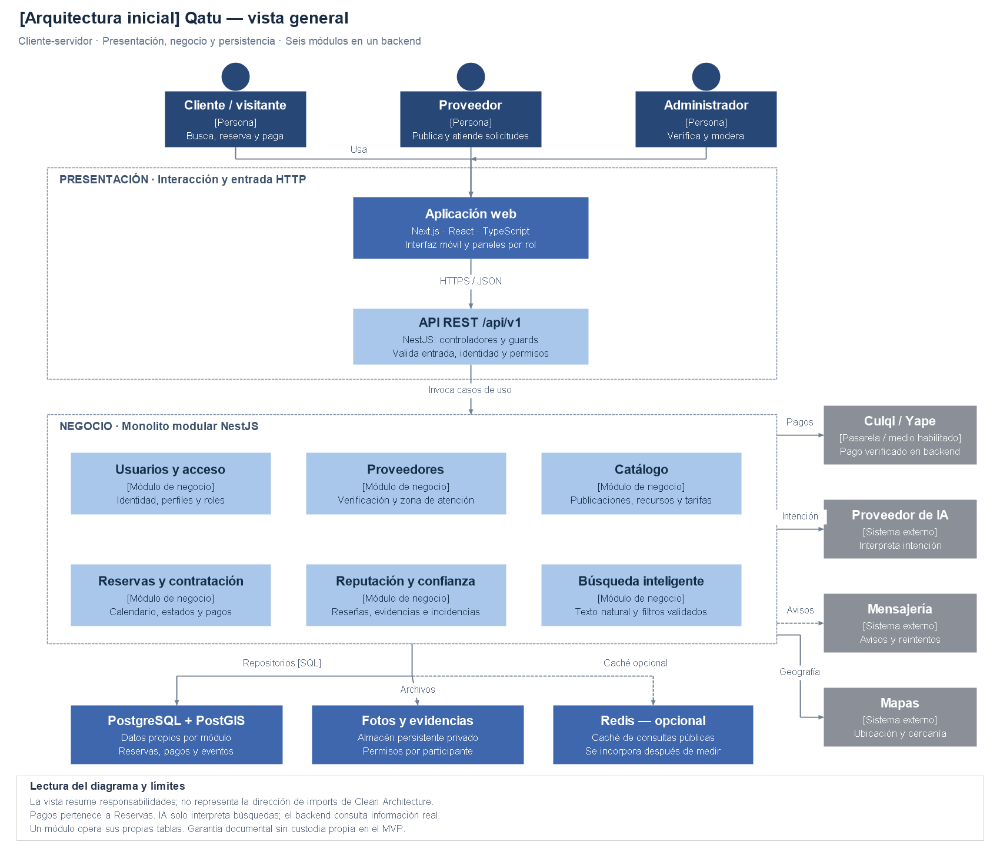
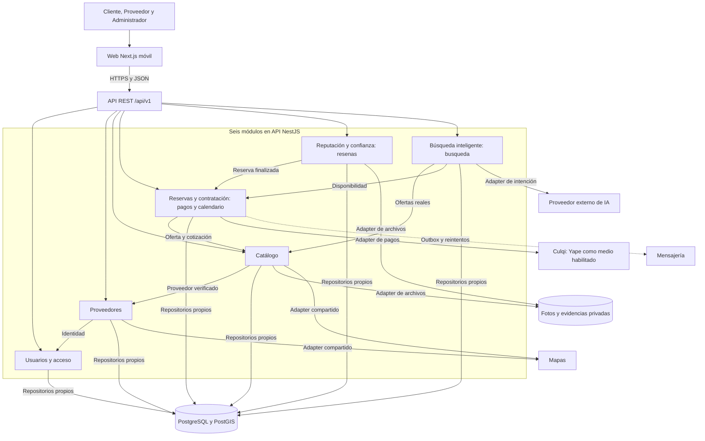

# Arquitectura inicial de Qatu

## Diagrama general de arquitectura

Vista del sistema completo: actores, presentación, seis módulos, persistencia e integraciones.

[PNG](./diagramas/png/arquitectura-inicial-qatu.png) · [SVG vectorial](./diagramas/svg/arquitectura-inicial-qatu.svg) · [Editable en diagrams.net](./diagramas/fuentes/arquitectura-inicial-qatu.drawio).

Para editar: diagrams.net → Archivo → Abrir desde → Dispositivo. Seleccionar el archivo .drawio. Las fuentes JSON están en diagramas/fuentes y los renderizadores en diagramas/scripts.

## Alcance y estado

MVP de alquiler de herramientas y contratación de oficios en Ayacucho, con pasarela de pago y búsqueda natural. Diseño actualizado a seis módulos; backend e integraciones pendientes de implementación. El prototipo web 001, disponible localmente en frontend/, ya permite explorar datos sintéticos. La propuesta de ecosistema con compraventa es evolución futura.

## Estructura general

Cliente-servidor con web Next.js y API NestJS como monolito modular. Vista resumida por presentación, negocio y persistencia; cada módulo usa internamente Clean Architecture. Las tres responsabilidades de esta vista no imponen imports hacia infraestructura.

## Módulos

| Módulo | Responsabilidad |
|---|---|
| Usuarios | Identidad, perfiles, varios roles y permisos |
| Proveedores | Oferta, zona, perfil y verificación |
| Catálogo | Publicaciones, recursos y tarifas; no decide aceptación |
| Reservas | Solicitudes, disponibilidad, estados, cotización y pagos |
| Reputación/confianza | Reseñas, entrega/devolución documentada e incidencias |
| Búsqueda inteligente | Texto → filtros validados → ofertas reales y fechas consultadas |

Catálogo no es dueño del calendario: Reservas controla los bloqueos por unidad física/agenda. Pagos no es un séptimo módulo; es componente interno de Reservas. Notificaciones y almacenamiento son soporte. Administración es una interfaz por permisos.

## Tecnologías y decisiones

| Elemento | Tecnología/decisión | Trazabilidad |
|---|---|---|
| Web | Next.js, React, TypeScript, diseño móvil | ADR-008 |
| Backend | NestJS/TypeScript sobre Node.js LTS vigente al implementar | ADR-001, ADR-002 |
| Datos | PostgreSQL, PostGIS para cercanía | ADR-006 |
| Búsqueda | Filtros y búsqueda textual; IA por adapter; pgvector posterior si procede | ADR-009 |
| Caché | Redis opcional después de medición | ADR-003 |
| Pagos | Culqi candidata con Yape habilitado; integración sandbox obligatoria | ADR-004, ADR-011 |
| Archivos | Volumen persistente privado; S3 compatible como alternativa | ADR-012 |
| Despliegue | Docker Compose en VPS, proxy HTTPS y copias externas | ADR-010 |

Node.js 20 ya está fuera de soporte; elegir y fijar versión LTS soportada antes de construir, según [estado oficial](https://nodejs.org/en/about/eol). No fijar aquí versiones antiguas de frameworks.

## Vistas detalladas

[C4 completo](../../README.md#modelo-c4) · [Componentes](./componentes-arquitectonicos.md) · [Estilo](./estilo-arquitectonico.md) · [Enfoque](./enfoque-arquitectonico.md) · [ADR](../01-analisis-de-sistema/07-desision-arquitectonica.md).

Los HTML y .architecture.json de Archify, junto con las imágenes anteriores, se conservan en [historico](../../README.md#historico-de-arquitectura). Los nuevos diagramas con sufijo -qatu, las vistas Mermaid y C4 enlazadas corresponden a la versión actual.
