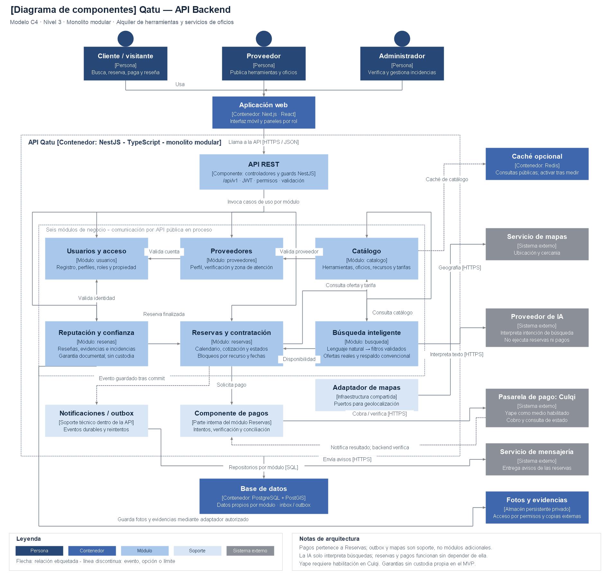

# Componentes arquitectónicos de Qatu

## Diagrama de componentes — API Backend

Vista C4 de nivel 3 adaptada al MVP de alquiler de herramientas y contratación de oficios en Ayacucho. Sigue el estilo visual del ejemplo Marketplace: personas, aplicación web, límite de API, módulos internos, datos y sistemas externos. Estado: diseño propuesto, implementación pendiente.

## Archivos y edición

- [Imagen PNG](./diagramas/png/componentes-qatu.png): para informe y presentación.
- [Versión SVG](./diagramas/svg/componentes-qatu.svg): vectorial para ampliar sin perder nitidez.
- [Archivo editable diagrams.net](./diagramas/fuentes/componentes-qatu.drawio): abrir en diagrams.net mediante Archivo → Abrir desde → Dispositivo.
- [Datos del diagrama](./diagramas/fuentes/componentes-qatu.json) y [renderizador PNG](./diagramas/scripts/render-componentes.ps1): fuentes reproducibles de la imagen.

## Seis módulos de negocio

| Componente | Responsabilidad |
|---|---|
| Usuarios y acceso | Registro, identidad, roles y autorización por propiedad |
| Proveedores | Perfil, verificación y zonas de atención |
| Catálogo | Publicaciones, recursos físicos, categorías y tarifas |
| Reservas y contratación | Solicitudes, calendario, cotización, estados y coordinación del pago |
| Reputación y confianza | Reseñas verificadas, evidencias, garantías documentales e incidencias |
| Búsqueda inteligente | Interpretar lenguaje natural, validar filtros y consultar ofertas/disponibilidad reales |

## Soporte e integraciones

Pagos es un componente interno de Reservas, no un séptimo módulo. Culqi procesa el pago y Yape es un medio sujeto a habilitación y pruebas de integración. El backend verifica importe, referencia y estado; gestiona intentos, eventos repetidos y conciliación.

Notificaciones/outbox publica eventos durables después del commit y reintenta entregas. Mapas utiliza un adaptador compartido. PostgreSQL almacena datos propios por módulo; cada módulo usa su repositorio y llama a otro mediante su API pública. Las fotografías y evidencias se almacenan con acceso autorizado; la garantía es documental, sin custodia propia en el MVP. Redis es opcional tras medir rendimiento.

La IA se integra mediante el adaptador de Búsqueda inteligente y solo interpreta la consulta. Reservas y pagos funcionan sin depender de ella. Ante falla de interpretación se ofrece búsqueda convencional. Los conectores de la imagen son relaciones funcionales de nivel 3; los adapters y puertos concretos se detallan en nivel 4.

Los componentes técnicos compartidos no se cuentan como módulos de negocio adicionales. Las validaciones de identidad se aplican transversalmente, aunque el resumen gráfico no dibuje cada guarda por módulo.

## Vistas relacionadas

[C4 nivel 3 completo](../04-modelo-c4/Nivel3-Diagrama-de-Componentes.md) · [Contenedores](../04-modelo-c4/Nivel2-DiagramadeContenedores.md) · [Código](../04-modelo-c4/Nivel4-DiagramadeCodigo.md) · [Decisiones](../01-analisis-de-sistema/07-desision-arquitectonica.md).
