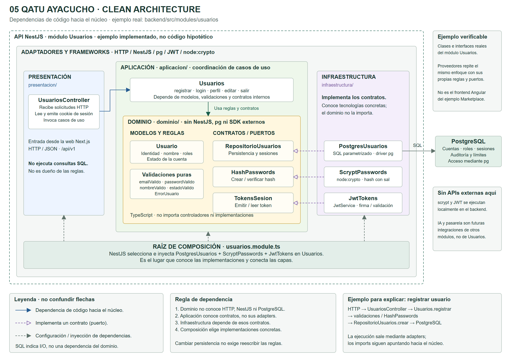
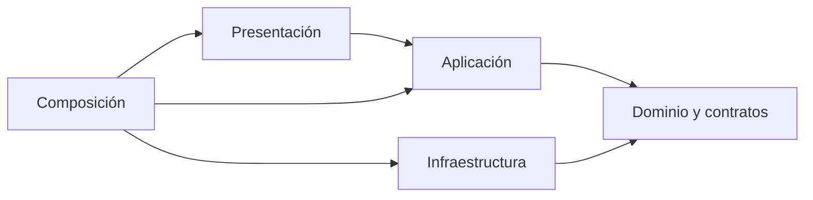

# Enfoque arquitectónico: Clean Architecture en Qatu

## Diagrama del enfoque Clean Architecture

Las flechas continuas muestran dependencias de código hacia el dominio; las discontinuas indican configuración e inyección desde la composición. Los adapters no son dependencias del dominio.

[PNG](./diagramas/png/enfoque-arquitectonico-qatu.png) · [SVG vectorial](./diagramas/svg/enfoque-arquitectonico-qatu.svg) · [Editable en diagrams.net](./diagramas/fuentes/enfoque-arquitectonico-qatu.drawio).

Para editar: diagrams.net → Archivo → Abrir desde → Dispositivo. Seleccionar el archivo .drawio. Las fuentes JSON están en diagramas/fuentes y los renderizadores en diagramas/scripts.

## Objetivo

Separar dominio y aplicación de NestJS, Next.js, PostgreSQL, Culqi y proveedor de IA. Se aplica dentro de cada módulo backend; el frontend también separa presentación, casos de uso de interfaz, contratos y adapters HTTP.

| Capa | Backend | Frontend |
|---|---|---|
| Presentación | Controllers, DTO y guards HTTP | Rutas Next.js, formularios y estado visual |
| Aplicación | AceptarReserva, IniciarPago, ConfirmarPago, BuscarEnLenguajeNatural | Consultar ofertas, enviar solicitud y consultar estado |
| Dominio | Reserva, RangoFechas, Dinero, IntentoPago y puertos | Modelos de lectura/validación de interfaz; no autoridad financiera |
| Infraestructura | PostgreSQL, Culqi, IA, archivos y mensajería | Cliente HTTP API, adapter de checkout público |
| Composición | module.ts y tokens de NestJS | Dependencias web y configuración pública |

## Regla de dependencia

Imports hacia el núcleo; el flujo de ejecución puede salir mediante adapters. La regla “solo llamar a la capa inferior” no significa importar infraestructura desde aplicación. Los puertos pueden ubicarse en dominio o aplicación según pertenencia; lo esencial es independencia de frameworks y tecnología.

## Autoridad y límites

Servidor calcula precios, valida disponibilidad, permisos y transiciones. Cliente muestra snapshot/cotización, no decide pago aprobado. Búsqueda valida texto no confiable y utiliza contratos de lectura. ProcesadorPagos maneja estados pendientes/desconocidos, no solo booleano aprobado.

[Diseño interno de módulos](../03-diseño-de-software/diseño-interno/diseño-interno-de-modulos.md) · [SOLID](../03-diseño-de-software/diseño-interno/principios-de-diseño.md) · [C4 código](../04-modelo-c4/Nivel4-DiagramadeCodigo.md).
