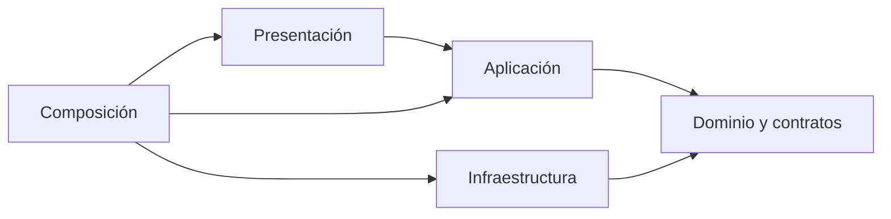

# Enfoque arquitectónico: Clean Architecture en Qatu

## Diagrama del enfoque Clean Architecture

Adaptación a Qatu del enfoque visto en clase, usando el módulo **Usuarios realmente implementado en el backend**. La imagen de referencia aplica Clean Architecture a Angular; Qatu utiliza Next.js y NestJS, por lo que no se reutilizan nombres de clases ni dependencias de ese ejemplo. Esta vista complementa la [estructura global del sistema](./estilo-arquitectonico.md).

[PNG](./diagramas/png/enfoque-arquitectonico-qatu.png) · [SVG vectorial](./diagramas/svg/enfoque-arquitectonico-qatu.svg) · [Editable en diagrams.net](./diagramas/fuentes/enfoque-arquitectonico-qatu.drawio).

Para ampliar, abrir el SVG o PNG. Para editar, usar diagrams.net → Archivo → Abrir desde → Dispositivo y seleccionar el archivo `.drawio`. Exportación reproducible y guía de lectura: [diagramas/README.md](./diagramas/README.md).

## Enfoque aplicado al proyecto

| Elemento | Descripción aplicada a Qatu Ayacucho |
|---|---|
| Patrón / enfoque | Clean Architecture dentro de los módulos del backend |
| Objetivo | Separar responsabilidades y orientar las dependencias hacia reglas y contratos internos |
| Problema que resuelve | Evitar que los casos de uso queden acoplados a controladores NestJS, SQL, JWT o futuros SDK de IA y pagos |
| Capas | Presentación, Aplicación, Dominio e Infraestructura; composición conecta sus implementaciones |
| Beneficios | Pruebas aisladas, cambios más localizados y sustitución de adaptadores por contratos |
| Costo y límite | Más estructura; la independencia exige respetar los imports. No proporciona aislamiento de procesos ni garantiza cambios sin esfuerzo |

## Evidencia real del diagrama

Todas las rutas siguientes parten de `backend/src/modules/usuarios/`.

| Responsabilidad | Archivo real | Qué demostrar |
|---|---|---|
| Presentación | `presentacion/usuarios.controller.ts` | `UsuariosController` recibe HTTP, procesa cookies e invoca casos de uso; no consulta PostgreSQL |
| Aplicación | `aplicacion/usuarios.ts` | `Usuarios` coordina registro, login y perfil usando validaciones y puertos |
| Dominio | `dominio/usuario.ts` | Modelo `Usuario`, validaciones y errores sin NestJS ni `pg` |
| Contratos internos | `dominio/puertos.ts` | `RepositorioUsuarios`, `HashPasswords` y `TokensSesion` |
| Persistencia | `infraestructura/postgres.ts` | `PostgresUsuarios` implementa el contrato y ejecuta SQL parametrizado |
| Contraseñas | `infraestructura/passwords.ts` | `ScryptPasswords` implementa hash y verificación mediante `node:crypto` |
| Tokens | `infraestructura/tokens.ts` | `JwtTokens` adapta `JwtService`; no se importa desde el dominio |
| Composición | `usuarios.module.ts` | `UsuariosModule` construye e inyecta las implementaciones en `Usuarios` |

Las flechas continuas de dependencia apuntan al núcleo; los triángulos huecos indican implementación de un contrato. Las discontinuas desde composición representan configuración e inyección. La flecha SQL muestra I/O con PostgreSQL, no una dependencia del dominio. scrypt y JWT son operaciones locales del backend, no llamadas a APIs externas.

## Ejemplo para explicar: registrar usuario

1. La web envía una solicitud de registro a la API.
2. `UsuariosController` recibe la entrada e invoca `Usuarios.registrar`.
3. El caso de uso valida los datos y solicita el hash mediante `HashPasswords`.
4. Solicita crear la cuenta mediante `RepositorioUsuarios`.
5. En ejecución, las implementaciones inyectadas son `ScryptPasswords` y `PostgresUsuarios`; esta última consulta PostgreSQL.
6. La sesión se emite mediante `TokensSesion`. El controlador devuelve la respuesta y configura la cookie.

El flujo puede salir hacia infraestructura mientras los imports permanecen hacia los contratos internos. Por eso `Usuarios` no importa `PostgresUsuarios`: la raíz de composición conecta ambos.

## Objetivo

Separar dominio y aplicación de NestJS, PostgreSQL y detalles de integración. Se aplica dentro de cada módulo backend. El frontend usa Next.js, componentes y clientes HTTP; no se presenta como una copia del esquema Angular de referencia ni se le atribuye autoridad sobre las reglas financieras del servidor.

La siguiente tabla describe la arquitectura objetivo más amplia. Los ejemplos de Reservas, pagos y Búsqueda son diseño futuro, no clases ya implementadas. El diagrama superior usa Usuarios precisamente para mostrar evidencia actual verificable.

| Capa | Backend | Frontend |
|---|---|---|
| Presentación | Controllers, DTO y guards HTTP | Rutas Next.js, formularios y estado visual |
| Aplicación | AceptarReserva, IniciarPago, ConfirmarPago, BuscarEnLenguajeNatural | Consultar ofertas, enviar solicitud y consultar estado |
| Dominio | Reserva, RangoFechas, Dinero, IntentoPago y puertos | Modelos de lectura/validación de interfaz; no autoridad financiera |
| Infraestructura | PostgreSQL, Culqi, IA, archivos y mensajería | Cliente HTTP API, adapter de checkout público |
| Composición | module.ts y tokens de NestJS | Dependencias web y configuración pública |

## Regla de dependencia

Imports hacia el núcleo; el flujo de ejecución puede salir mediante adapters. La regla “solo llamar a la capa inferior” no significa importar infraestructura desde aplicación. Los puertos pueden ubicarse en dominio o aplicación según pertenencia; lo esencial es independencia de frameworks y tecnología.

## Autoridad y límites

Servidor calcula precios, valida disponibilidad, permisos y transiciones. Cliente muestra snapshot/cotización, no decide pago aprobado. Búsqueda valida texto no confiable y utiliza contratos de lectura. ProcesadorPagos maneja estados pendientes/desconocidos, no solo booleano aprobado.

[Diseño interno de módulos](../03-diseño-de-software/diseño-interno/diseño-interno-de-modulos.md) · [SOLID](../03-diseño-de-software/diseño-interno/principios-de-diseño.md) · [C4 código](../04-modelo-c4/Nivel4-DiagramadeCodigo.md).

## Resumen para exposición

> Clean Architecture no define cuántos servidores tenemos: define quién puede depender de quién. En Usuarios, la aplicación conoce contratos internos y la infraestructura los implementa. Esto permite probar los casos de uso con dobles de prueba y cambiar detalles tecnológicos sin trasladarlos al dominio. El estilo global sigue siendo monolito modular.
