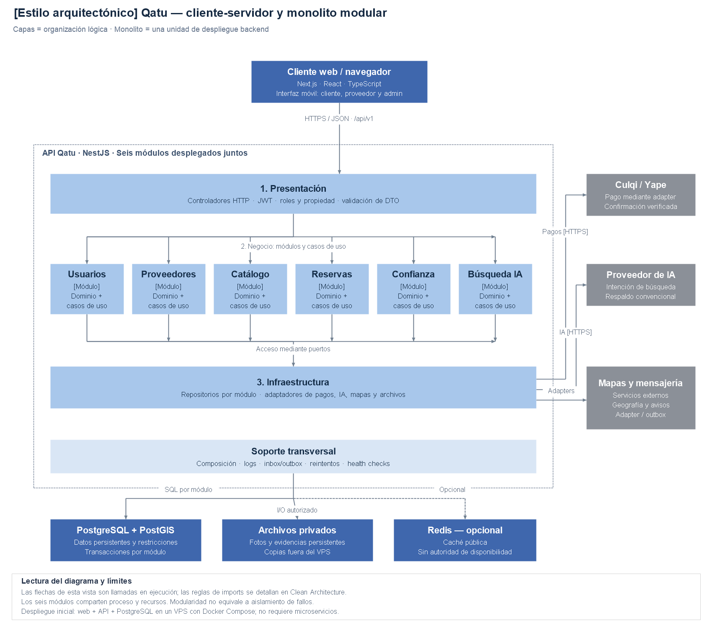

# Estilo arquitectónico de Qatu

## Diagrama del estilo arquitectónico

Vista de ejecución del cliente-servidor y el monolito modular en capas. Los módulos se despliegan juntos; las llamadas a infraestructura se realizan mediante puertos, sin invertir la regla de imports.

[PNG](./diagramas/png/estilo-arquitectonico-qatu.png) · [SVG vectorial](./diagramas/svg/estilo-arquitectonico-qatu.svg) · [Editable en diagrams.net](./diagramas/fuentes/estilo-arquitectonico-qatu.drawio).

Para editar: diagrams.net → Archivo → Abrir desde → Dispositivo. Seleccionar el archivo .drawio. Las fuentes JSON están en diagramas/fuentes y los renderizadores en diagramas/scripts.

## Selección

Cliente-servidor + monolito modular. Frontend Next.js y API NestJS se despliegan como aplicaciones separadas; los seis módulos backend se publican juntos. Capas son organización lógica y contenedores C4 son aplicaciones/almacenes, no equivalentes a módulos.

## Justificación

| Driver | Respuesta del estilo |
|---|---|
| DA01/DA11 | Backend único económico; optimización y dimensionamiento medidos antes de réplicas |
| DA02 | PostgreSQL indexado y paginación; caché opcional |
| DA03 | Autenticación, roles, propiedad, HTTPS y datos privados |
| DA04/DA12 | Componente de pagos dentro de Reservas, adapter y confirmación fiable |
| DA05 | Contrato REST /api/v1 entre web/API |
| DA06 | Integraciones por puertos, avisos durables y degradación controlada |
| DA07 | Seis módulos con API pública y Clean Architecture interna |
| DA08 | Transacciones y exclusión por recurso/rango |
| DA09 | Interfaz móvil, imágenes optimizadas y filtros editables |
| DA10 | Búsqueda depende de lectura de Catálogo/Reservas; operaciones no dependen de IA |
| DA13 | Confianza y archivos privados separados del pago del alquiler |

## Alternativas

Microservicios implican redes, despliegues, observabilidad y consistencia distribuida adicionales; se postergan hasta una necesidad medida. SOA/ESB no responde al tamaño actual. Eventos se usan para soporte durable, sin convertir toda la solución en event sourcing. Serverless no se elige para el VPS requerido; no se afirma que sea incapaz de hacer transacciones.

## Reglas

1. Dominio y casos de uso dependen de contratos internos, no de SDK/ORM.
2. Un módulo no consulta tablas/repositories ajenos.
3. Fachadas públicas devuelven DTO estables.
4. Módulos comparten proceso, recursos y despliegue; modularidad no garantiza aislamiento de fallos de proceso.
5. No mantener transacción abierta durante una llamada a pasarela/IA.
6. Vencimiento, cancelación y confirmación actualizan bloqueos atómicamente.
7. Eventos outbox se guardan con cambio de negocio; publicación después del commit.

## Vistas

[Resumen vigente](./arquitectura-inicial.md), [C4 componentes](../04-modelo-c4/Nivel3-Diagrama-de-Componentes.md) y [VPS](../04-modelo-c4/despliegue-vps.md). Los diagramas anteriores de cinco módulos son históricos.
