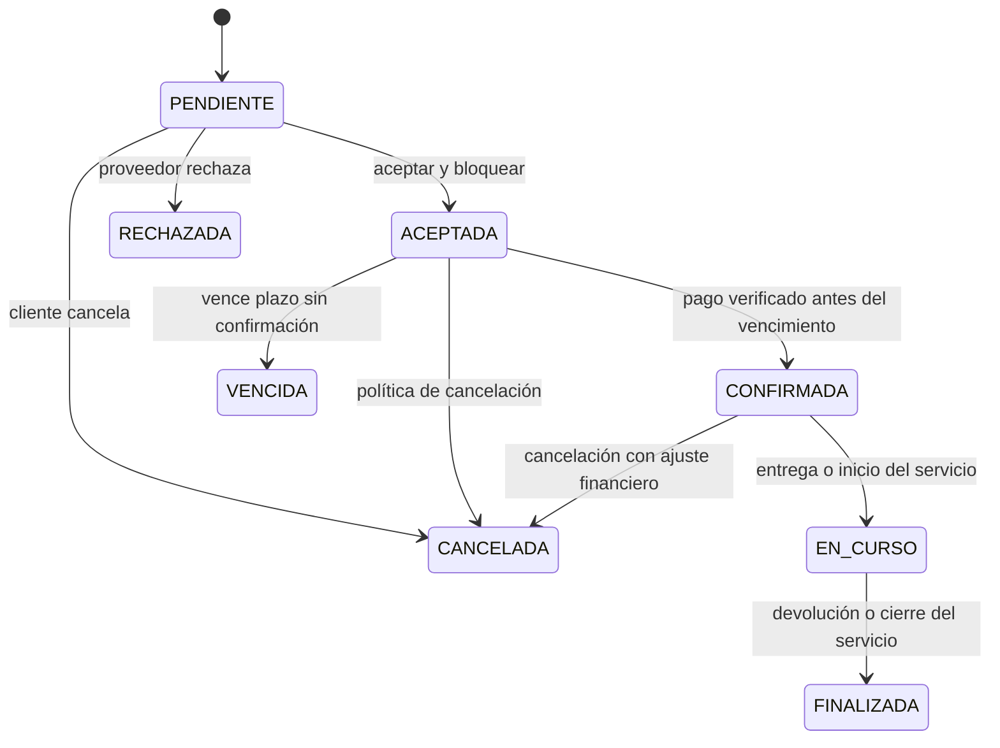

# Diseño interno de módulos de Qatu

> Backend: NestJS y TypeScript. Clean Architecture dentro del monolito modular. Estado: diseño propuesto, pendiente de implementación.

## 1. Propósito y módulos

Definir estructura, contratos, propiedad de datos y flujos de los seis módulos. Pagos es un componente de Reservas; administración es una interfaz con permisos sobre los módulos.

| Módulo | Datos propios | API pública prevista |
|---|---|---|
| usuarios | usuarios, roles_usuario | IdentidadUsuarios: identidad y permisos |
| proveedores | proveedores, verificaciones | ConsultaProveedores: perfil y estado |
| catalogo | publicaciones, categorias, recursos, tarifas | ConsultaCatalogo: ofertas activas y cotización |
| reservas | reservas, bloqueos, intentos_pago, eventos_pasarela, outbox_eventos | ConsultaDisponibilidad y casos de uso de reserva/pago |
| resenas | resenas, garantias_documentadas, evidencias, incidencias | RegistroConfianza: evidencia y reseña |
| busqueda | métricas agregadas y configuración de consumo; sin copia autoritativa del catálogo | BuscarEnLenguajeNatural y filtros convencionales |

El módulo resenas conserva su nombre técnico existente y amplía su responsabilidad a Reputación y confianza. Catálogo describe recursos; Reservas es dueño del calendario y bloqueos. Una publicación de herramienta puede tener varias unidades físicas, cada una con recursoId estable. Los servicios usan recursos de agenda del proveedor; inicialmente una atención simultánea por agenda.

## 2. Estructura prevista de código

```text
backend/src/modules/
├── usuarios/
├── proveedores/
├── catalogo/
├── resenas/
├── busqueda/
│   ├── dominio/criterios-busqueda.ts
│   ├── dominio/interprete-intencion.ts
│   ├── aplicacion/buscar-en-lenguaje-natural.caso-uso.ts
│   ├── infraestructura/modelo-lenguaje.adapter.ts
│   ├── presentacion/busqueda.controller.ts
│   ├── busqueda.module.ts
│   └── index.ts
└── reservas/
    ├── dominio/
    │   ├── reserva.ts
    │   ├── rango-fechas.ts
    │   ├── dinero.ts
    │   ├── repositorio-reservas.ts
    │   ├── unidad-trabajo-reservas.ts
    │   └── pagos/
    │       ├── intento-pago.ts
    │       ├── procesador-pagos.ts
    │       └── resultado-pago.ts
    ├── aplicacion/
    │   ├── solicitar-reserva.caso-uso.ts
    │   ├── aceptar-reserva.caso-uso.ts
    │   ├── iniciar-pago.caso-uso.ts
    │   ├── confirmar-pago.caso-uso.ts
    │   ├── vencer-reserva.caso-uso.ts
    │   └── conciliar-pago.caso-uso.ts
    ├── infraestructura/
    │   ├── postgres-reservas.repository.ts
    │   ├── postgres-unidad-trabajo.ts
    │   ├── culqi-pago.adapter.ts
    │   └── publicador-outbox.ts
    ├── presentacion/
    │   ├── reservas.controller.ts
    │   └── pagos-webhook.controller.ts
    ├── reservas.module.ts
    └── index.ts
```

Esta estructura es una especificación; no se crean clases vacías que aparenten implementación. En NestJS, cada archivo module.ts conecta tokens de inyección e implementaciones. Las interfaces TypeScript necesitan tokens de runtime para inyección.

## 3. Capas y dependencias

| Capa | Puede depender de | Responsabilidad |
|---|---|---|
| Dominio | Dominio y primitivas puras | Entidades, invariantes y puertos |
| Aplicación | Dominio y contratos públicos importados mediante puertos locales | Orquestación y autorizaciones del caso de uso |
| Infraestructura | Dominio, contratos de aplicación cuando corresponda y librerías externas | Repositorios, adapters y transacciones |
| Presentación | Aplicación y DTO de entrada/salida | HTTP, autenticación inicial, validación y traducción de errores |
| Composición | Todas las capas | Selección de implementaciones |

El dominio no importa framework/ORM. Ningún módulo lee tablas ni repositories ajenos. La fachada publicada devuelve DTO, no entidades ORM. Un módulo consumidor declara su puerto; un adaptador interno delega en la fachada del módulo proveedor. Las dependencias de módulos son un DAG: proveedores → usuarios; catalogo → proveedores; reservas → catalogo/usuarios; resenas → reservas/usuarios; busqueda → catalogo/reservas. Reservas publica eventos; no importa resenas para registrar evidencias.

## 4. Reglas de negocio

| Regla | Definición |
|---|---|
| RN01 | Solo proveedor activo/verificado publica; solo propietario o administrador autorizado modifica |
| RN02 | Fecha inicio < fin; intervalos [inicio, fin); instantes en UTC y presentación America/Lima |
| RN03 | Solapamiento por recursoId en estados bloqueantes se rechaza en PostgreSQL |
| RN04 | Solicitud pendiente no bloquea; aceptación crea bloqueo y vence provisionalmente a los 15 minutos si no hay pago confirmado |
| RN05 | Servidor calcula cotización y conserva snapshot de tarifa/condiciones; cliente no decide importe |
| RN06 | Importes en céntimos enteros y moneda PEN; comisión no se calcula sobre garantía |
| RN07 | Confirmación de pago exige referencia, importe, moneda y evidencia externa verificada |
| RN08 | Pago/evento repetido no repite efecto; timeout produce estado desconocido y conciliación |
| RN09 | Servicio de precio variable requiere cotización aceptada antes de pagar |
| RN10 | Entrega/devolución registran evidencia y participantes; una reserva solo finaliza al completar el cierre correspondiente |
| RN11 | Solo participante de una reserva finalizada puede reseñar; una reseña por cliente y reserva |
| RN12 | IA solo interpreta consultas y consulta datos autorizados; no escribe operaciones ni genera SQL libre |

El plazo de 15 minutos y tarifas por unidad son políticas propuestas que deben validarse. Cobro tardío después del vencimiento no reactiva una reserva ocupada: registrar pago recibido, abrir conciliación/reembolso y notificar. Procesos de expiración y confirmación comparten bloqueo de fila/versión para evitar carreras. Mientras un pago iniciado es desconocido, el proceso consulta a la pasarela; la política de pago tardío evita doble asignación.

## 5. Estados independientes



Reserva: pendiente, aceptada, confirmada, en_curso, finalizada, rechazada, cancelada o vencida. Pago: creado, pendiente, desconocido, aprobado, rechazado, reembolso_pendiente o reembolsado. Garantía documental: acordada, entrega_registrada, devolución_registrada, liberación_reportada, ajuste_reportado o en_disputa. Los estados de garantía describen registros y confirmaciones; no acreditan custodia o movimientos bancarios.

## 6. Transacción y pago

AceptarReserva comprueba propietario, cotización, fechas y recurso; guarda reserva, bloqueo y outbox en una transacción. La exclusión GiST por recursoId/rango se aplica a bloqueos activos; cancelación/vencimiento libera el bloqueo explícitamente en transacción. La BD no usa now() en un índice parcial para vencimiento: un proceso cambia el estado.

IniciarPago guarda intento/clave única y el importe antes de salir a la pasarela. No mantiene una transacción abierta durante I/O. ConfirmarPago verifica proveedor, deduplica evento y actualiza intento/reserva/outbox en una transacción local. ConciliarPago consulta el recurso externo cuando la respuesta es incierta. Si dos clics simultáneos usan claves distintas, una restricción por reserva y operación debe impedir dos intentos activos.

## 7. Contratos de referencia

```ts
// Especificación TypeScript; implementación pendiente.
type ResultadoPago =
  | { estado: "aprobado"; referencia: string }
  | { estado: "pendiente"; referencia: string }
  | { estado: "rechazado"; motivo: string }
  | { estado: "desconocido"; referencia?: string };
interface ProcesadorPagos {
  iniciar(input: { intentoId: string; operacionId: string; montoCentimos: number; moneda: "PEN"; token: string }): Promise<ResultadoPago>;
  consultar(referencia: string): Promise<ResultadoPago>;
}
interface InterpreteIntencion {
  interpretar(texto: string, contexto: { fechaReferencia: string; zonaHoraria: "America/Lima" }): Promise<unknown>;
}
interface CriteriosBusqueda {
  tipo?: "herramienta" | "servicio";
  categoriaId?: string;
  zonaId?: string;
  inicio?: string;
  fin?: string;
  precioMaximoCentimos?: number;
}
```

La respuesta unknown de IA se valida contra esquema antes de convertirse en CriteriosBusqueda. Zonas y categorías se resuelven contra IDs reales. No registrar tokens de pago, secretos ni texto sensible completo. Reloj se inyecta para probar vencimientos y fechas relativas.

## 8. Errores y pruebas

| Caso | Respuesta prevista |
|---|---|
| Entrada inválida | 400 |
| Sin autenticación / sin permiso | 401 / 403 |
| Recurso inexistente o privado no visible | 404 |
| Fechas ocupadas o transición incompatible | 409 |
| Límite de solicitudes | 429 |
| Pago pendiente/desconocido persistido | 202 y consulta de estado |
| Pasarela temporalmente no disponible | Error controlado; sin confirmación ficticia |

Pruebas: tarifas/estados con unidades; solapamiento/transacciones con PostgreSQL; contratos con doubles y sandbox; EQ-08 para cobros; EQ-02/EQ-10 para IA. [C4 nivel 4](../../04-modelo-c4/Nivel4-DiagramadeCodigo.md) contiene clases y secuencias.
