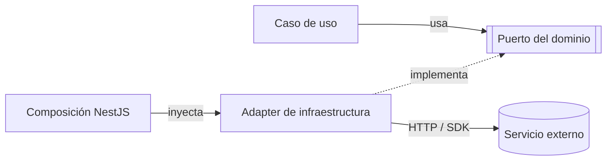

# Patrón de diseño de Qatu: Adapter

## Objetivo

Qatu adopta un único patrón de diseño explícito: **Adapter**. Se aplica en cada punto donde el backend depende de un servicio externo o de una tecnología reemplazable, para que los casos de uso y el dominio no conozcan APIs, formatos, códigos de error ni SDK de terceros.

## Problema que resuelve

Las integraciones de Qatu (pasarela de pagos, inteligencia artificial, mapas, almacenamiento de archivos, caché y mensajería) tienen contratos propios que pueden cambiar o fallar. Si las reglas de negocio llamaran directamente a esas APIs:

- un cambio de proveedor obligaría a modificar casos de uso y reglas;
- los errores externos (timeout, cuota agotada, respuesta inválida) se mezclarían con la lógica del negocio;
- no se podría probar el dominio sin conectarse a terceros.

## Solución y estructura

El caso de uso depende de un **puerto** (interfaz definida en el dominio). El **adapter** implementa ese puerto y traduce, en ambos sentidos, entre el lenguaje de Qatu y la API externa. La raíz de composición de NestJS decide qué adapter se inyecta.

| Rol | Responsabilidad | Ejemplo |
|---|---|---|
| Cliente | Caso de uso que necesita la capacidad | `IniciarPagoReserva` |
| Puerto (target) | Contrato expresado en términos de Qatu | `ProcesadorPagos` |
| Adapter | Traduce datos, estados y errores | `CulqiPagoAdapter` |
| Adaptado (adaptee) | API o SDK externo | API de cargos de Culqi |

## Aplicación en Qatu

| Puerto | Adapter | Servicio externo | Módulo | Estado |
|---|---|---|---|---|
| `ProcesadorPagos` | `CulqiPagoAdapter` | Culqi (tarjeta y Yape habilitado por la pasarela) | Reservas | Diseñado; integración real pendiente (D08) |
| `InterpreteIntencion` | `ModeloLenguajeAdapter` | Proveedor de IA (modelo por seleccionar) | Búsqueda | Diseñado |
| `ServicioMapas` | `MapasAdapter` | Mapas y geocodificación (proveedor por definir) | Proveedores / Catálogo | Diseñado; distrito manual como respaldo |
| `AlmacenArchivos` | `AlmacenLocalAdapter` → `AlmacenS3Adapter` | Volumen persistente del VPS; luego almacenamiento S3 compatible | Catálogo / Reseñas | Diseñado |
| `CacheConsultas` | `RedisCacheAdapter` | Redis (opcional) | Catálogo / Búsqueda | Opcional; se activa solo si EQ-01 lo justifica |
| `Notificador` | `MensajeriaAdapter` | Mensajería (proveedor por definir) | Reservas | Puerto, despachador y canal dentro de la app implementados; canal externo pendiente |
| `TokensSesion` | `JwtTokens` | `JwtService` de NestJS | Usuarios | **Implementado** |
| `HashPasswords` | `ScryptPasswords` | `node:crypto` (scrypt) | Usuarios | **Implementado** |
| `RepositorioUsuarios` | `PostgresUsuarios` | PostgreSQL mediante `pg` | Usuarios | **Implementado** |

Los tres últimos están en `backend/src/modules/usuarios/infraestructura/` y demuestran el patrón con código real; los demás son diseño por implementar.

## Cómo funciona cada adapter

### Pagos con Culqi

1. El navegador tokeniza la tarjeta en el checkout de Culqi con la llave pública; Qatu nunca recibe datos de tarjeta.
2. El caso de uso calcula el importe en el servidor y llama a `ProcesadorPagos.cobrar(...)`.
3. `CulqiPagoAdapter` persiste antes el intento con una clave de operación, envía el cargo con la llave privada y traduce la respuesta a `ResultadoPago`: `pendiente`, `aprobado`, `rechazado` o `desconocido`.
4. Un timeout se traduce como `desconocido`, no como rechazo: se concilia consultando el cargo, sin cobrar otra vez a ciegas.
5. Las notificaciones de Culqi se verifican consultando el recurso por API autenticada, porque la documentación consultada no describe firma ni formato; un evento repetido se ignora por su identificador.

### Búsqueda con IA

1. `InterpreteIntencion.interpretar("taladro en Huamanga")` devuelve solo **filtros estructurados** (categoría, zona, presupuesto).
2. `ModeloLenguajeAdapter` envía la consulta al proveedor, valida la respuesta contra un esquema cerrado y descarta valores desconocidos.
3. Precio y disponibilidad siempre salen de PostgreSQL, nunca de la IA. La IA no genera SQL ni ejecuta escrituras.
4. Si hay timeout (3 s de interpretación, 5 s en total), cuota agotada o JSON inválido, el adapter devuelve un error controlado y la búsqueda continúa con filtros convencionales.

### Mapas

`ServicioMapas` ofrece geocodificación y cálculo de zona. Si el proveedor no responde, Qatu sigue funcionando con el **distrito elegido manualmente**; los mapas nunca deciden disponibilidad ni el estado de una reserva.

### Imágenes y evidencias

`AlmacenArchivos` guarda el binario y PostgreSQL guarda solo la metadata (ruta, tipo, tamaño y hash). En el MVP el adapter escribe en un **volumen persistente del VPS** incluido en las copias de respaldo. Las fotos del catálogo se sirven por una ruta controlada; las evidencias privadas exigen permiso por reserva y URL temporal. Cambiar a almacenamiento S3 compatible solo requiere otro adapter.

### Caché con Redis

`CacheConsultas` permite guardar temporalmente resultados de consultas públicas (catálogo y búsquedas frecuentes). `RedisCacheAdapter` se activa únicamente si las pruebas de carga EQ-01 demuestran que hace falta. La caché se invalida al editar o desactivar una publicación y **nunca decide** la aceptación de una reserva: la disponibilidad final siempre se comprueba en PostgreSQL. Si Redis falla, la consulta va directo a la base de datos.

### Mensajería

`Notificador` envía avisos (solicitud recibida, aceptada, vencida). Los avisos se registran en la base de datos y se reintentan; un fallo de mensajería no revierte una reserva ya confirmada.

## Reglas del patrón en Qatu

1. Los puertos se definen en el dominio y usan tipos de Qatu, no tipos del SDK externo.
2. El adapter traduce formatos, estados y errores; **no contiene reglas de negocio** (tarifas, fechas, permisos).
3. Todo adapter externo define timeout y devuelve errores controlados; no se reintenta sin límite.
4. No se mantiene una transacción SQL abierta mientras el adapter llama a un tercero.
5. Cada adapter tiene pruebas de contrato y un doble de prueba para los casos de uso.
6. Cambiar de proveedor significa escribir otro adapter y cambiar la composición, sin modificar casos de uso. Si el nuevo proveedor no ofrece una capacidad equivalente, se revisa el contrato del puerto antes de sustituirlo.

## Trazabilidad

| Driver | Decisión | Uso del Adapter |
|---|---|---|
| DA04 / DA12 | ADR-004 / ADR-011 | `CulqiPagoAdapter` con pagos verificados |
| DA06 | ADR-005 | `MapasAdapter` y `MensajeriaAdapter` con degradación controlada |
| DA10 | ADR-009 | `ModeloLenguajeAdapter` de solo lectura con respaldo convencional |
| DA02 | ADR-003 | `RedisCacheAdapter` opcional tras medir |
| DA13 | ADR-010 / ADR-012 | `AlmacenArchivos` con metadata en BD y copias externas |

[ADR](../../01-analisis-de-sistema/07-desision-arquitectonica.md) · [Escenarios](../../01-analisis-de-sistema/08-escenarios-atributos-calidad.md) · [Principios](./principios-de-diseño.md) · [C4 componentes](../../04-modelo-c4/Nivel3-Diagrama-de-Componentes.md).
