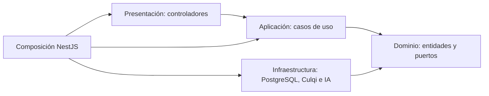

# Principios de diseño de Qatu

## Objetivo y contexto

Aplicar SOLID al backend NestJS/TypeScript con Clean Architecture. Referencias: Reservas con pagos y Búsqueda inteligente. Los nombres de clases representan diseño por implementar.

| Principio | Aplicación en Qatu | Elementos previstos | Comprobación |
|---|---|---|---|
| S - Responsabilidad única | Separar HTTP, reglas, coordinación, persistencia y llamadas externas | ReservasController, AceptarReservaCasoUso, Reserva, PostgresReservasRepository, CulqiPagoAdapter | El controlador no calcula tarifas ni confirma pagos |
| O - Abierto/cerrado | Añadir adaptadores compatibles sin modificar reglas del negocio | ProcesadorPagos, InterpreteIntencion, composición | Cambia infraestructura, no reglas de fechas |
| L - Sustitución de Liskov | Conservar estados, errores e invariantes del contrato | ResultadoPago: pendiente, aprobado, rechazado o desconocido | Timeout no significa rechazo; pruebas de contrato |
| I - Segregación de interfaces | Puertos pequeños por necesidad | ConsultaCatalogo, ConsultaDisponibilidad, RepositorioReservas | La IA no recibe permisos para cobrar o reservar |
| D - Inversión de dependencias | Casos de uso reciben puertos, adaptadores los implementan | UnidadTrabajoReservas, Reloj, InterpreteIntencion | Dominio sin NestJS, TypeORM, React, fetch ni SDK |

Cambiar de proveedor puede requerir adaptar capacidades nuevas; SOLID no garantiza que dos APIs ofrezcan las mismas funciones. Verificar el contrato mínimo antes de sustituirlas.

## Dependencias

Las flechas son imports, no el recorrido de una petición. En ejecución el caso de uso llama al puerto y la implementación realiza I/O.

## Principios complementarios

- Alta cohesión: Reservas concentra calendario, ciclo de operación y coordinación de pagos.
- Bajo acoplamiento: módulos publican contratos por su API pública; no comparten repositorios ni entidades ORM.
- DRY: servidor calcula una cotización autorizada; frontend presenta esa cotización.
- KISS: seis módulos en un backend, búsqueda estructurada antes de motores vectoriales.
- YAGNI: compraventa, ERP, aplicación móvil nativa y custodia propia quedan fuera del MVP.
- Privilegio mínimo: verificar rol y propietario.
- Fuente confiable: IDs, importes y disponibilidad proceden del sistema; no de IA o del cliente.

## Aplicación a cambios

| Cambio | Diseño propuesto |
|---|---|
| Sustituir Culqi | Adaptador, configuración y pruebas de contrato |
| Sustituir IA | Adaptador y evaluación EQ-10, manteniendo esquema de filtros |
| Cambiar plazo de aceptación | Política de vencimiento y pruebas con Reloj |
| Añadir categoría | Catálogo, sin modificar autenticación o pago |
| Verificar solapamientos | PostgreSQL real; dobles solo para pruebas unitarias |

## Trazabilidad

DA07 → ADR-002 → SOLID → EQ-05. DA04/DA12 → ADR-004/ADR-011 → contratos de pagos → EQ-08. DA10 → ADR-009 → puertos de lectura → EQ-02/EQ-10.

[Patrones](./patrones-de-diseño.md) · [Diseño interno](./diseño-interno-de-modulos.md) · [C4 código](../../04-modelo-c4/Nivel4-DiagramadeCodigo.md).
