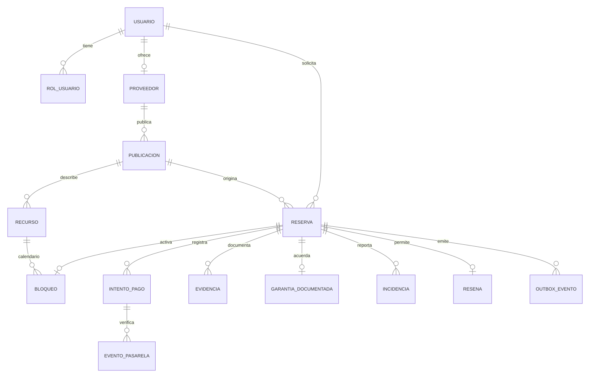
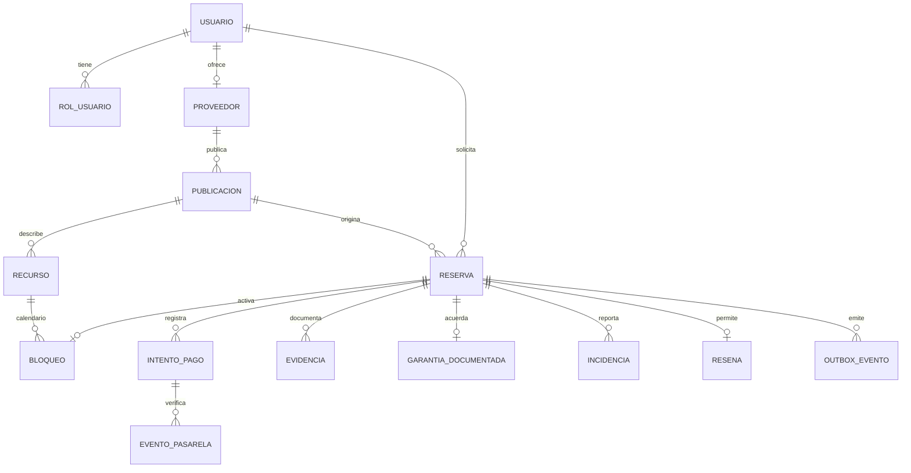

# Modelo de datos de Qatu

## Objetivo

Vista lógica propuesta para alquiler de herramientas y servicios. No es una migración ejecutada. Conserva propiedad de datos por módulo aunque comparta PostgreSQL.

## Diagrama entidad-relación

[Ver SVG](../04-modelo-c4/diagramas/modelo-de-datos.svg) · [Fuente Mermaid editable](../04-modelo-c4/diagramas/modelo-de-datos-1.mmd).

Ver código Mermaid

## Datos e invariantes

| Entidad | Campos principales | Restricciones propuestas | Módulo |
|---|---|---|---|
| usuario / rol_usuario | id, email, hash, estado; rol | Email normalizado único; varios roles por cuenta | usuarios |
| proveedor | usuarioId, estadoVerificacion, zonaId | Un perfil por cuenta; verificación privada | proveedores |
| publicacion | proveedorId, tipo, categoriaId, tarifaCentimos, unidadTarifa, activa | Tipo herramienta/servicio; importe no negativo | catalogo |
| recurso | publicacionId, clase, identificador | Unidad física o agenda estable; no confundir stock con calendario | catalogo |
| reserva | clienteId, proveedorId, publicacionId, recursoId, inicio, fin, snapshot, estado, venceEn, version | Intervalo válido; transiciones autorizadas | reservas |
| bloqueo | reservaId, recursoId, rango, activo | GiST EXCLUDE (recursoId igualdad, rango solapamiento) WHERE activo; reservaId único | reservas |
| intento_pago | reservaId, operacionId, clave, montoCentimos, moneda, referencia, estado | Clave local única; operación única; un intento activo por reserva/operación | reservas |
| evento_pasarela | proveedor, eventoId, referencia, recibidoEn, estado | Único por proveedor/evento; estado verificado antes de efecto | reservas |
| outbox_evento | id, agregadoId, tipo, payloadMinimo, estado, intentos, proximoIntento | Se guarda con modificación del agregado; entrega por consumidor deduplicada | reservas |
| evidencia | reservaId, autorId, etapa, ruta, hash, fecha | Archivo privado; permisos, tipo/tamaño y referencia válida | resenas |
| garantia_documentada | reservaId, montoCentimos, condiciones, estado | Garantía sin comisión y sin custodia propia; una por reserva | resenas |
| incidencia | reservaId, autorId, motivo, estado, resolucion | Revisión humana y auditoría | resenas |
| resena | reservaId, clienteId, puntuacion, texto, moderacion | Puntuación 1-5; una por cliente/reserva; operación finalizada | resenas |

Las relaciones entre módulos son referencias lógicas, no permiso de lectura directa. FK pueden reforzar integridad en el monolito; cada módulo usa la API pública para reglas. Restricción de exclusión se implementa con rangos PostgreSQL y btree_gist para el ID escalar. Los cambios de estado liberan bloqueo explícitamente; no confiar en un índice basado en reloj.

## Consistencia y seguridad

Implementación Proveedores 003: zonas_proveedor y proveedores propios con unicidad por usuario, versión y visibilidad explícita; verificaciones_proveedor conserva consentimiento/snapshot/decisión/motivo/revisor/fecha; documentos_proveedor guarda metadatos y contenido cifrado, IV/tag, sin nombres originales. FK a Usuarios refuerzan integridad, pero la aplicación consulta identidad por fachada. Limpieza de inactivos conserva historial y elimina adjuntos. [Detalle físico y migraciones](../../specs/003-proveedores-verificacion/data-model.md).

Implementación Usuarios US3 (2026-10-19): la migración backend/migrations/usuarios/002-administracion.sql añade auditoria_usuarios, propia de Usuarios, con actor/cuenta/acción/estado anterior y nuevo/motivo/fecha. Aprovisionamiento CLI registra actor null; cambios HTTP exigen actor admin activo. Estado, revocación y auditoría se confirman juntos. El modelo lógico de los demás módulos sigue siendo propuesto; ver [detalle físico de Usuarios](../../specs/002-usuarios-acceso/data-model.md).

Snapshot de reserva conserva precio, unidad, cantidad, comisión, condiciones y total cobrable; garantía se muestra separada y se gestiona documentalmente en MVP. No guardar tarjetas, CVV, secretos de IA ni tokens de pago reutilizables. Auditar actor, acción, entidad, resultado y fecha con datos mínimos.

Índices previstos: categoría/zona/estado de publicación; participante/estado/fecha de reserva; operaciones y referencias de pago; estados/fecha de outbox. Añadir búsqueda textual; PostGIS para cercanía cuando corresponda. pgvector se evalúa posteriormente con evidencia EQ-10.

[Diseño interno](./diseño-interno/diseño-interno-de-modulos.md) · [PostgreSQL: rangos y exclusión](https://www.postgresql.org/docs/17/rangetypes.html).
