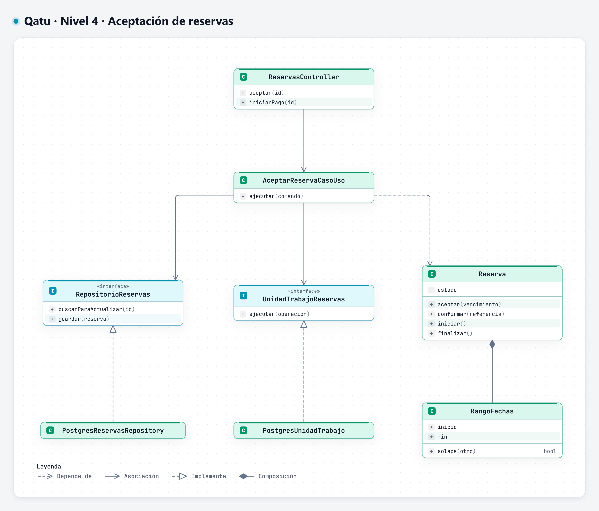
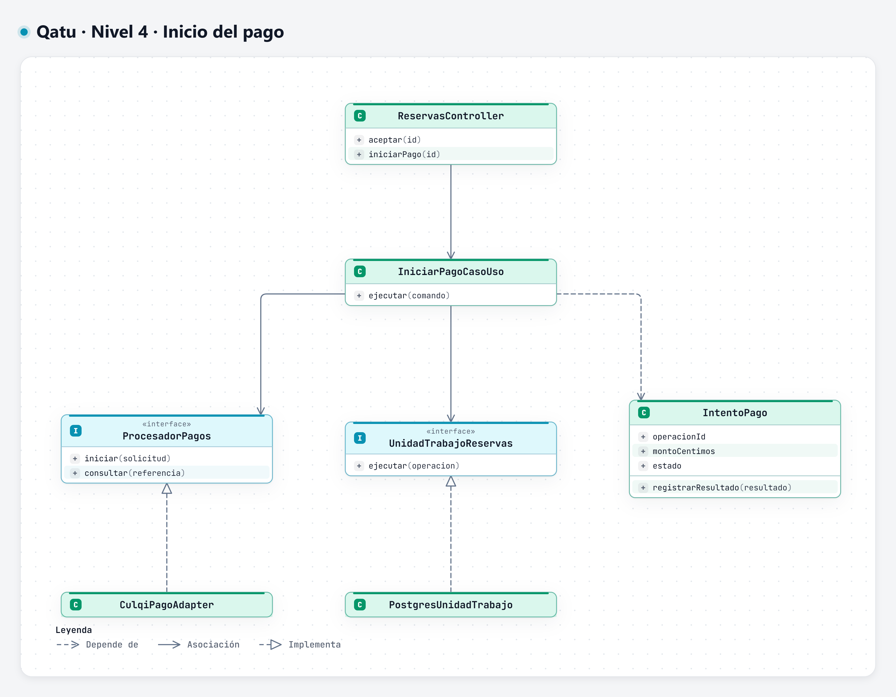
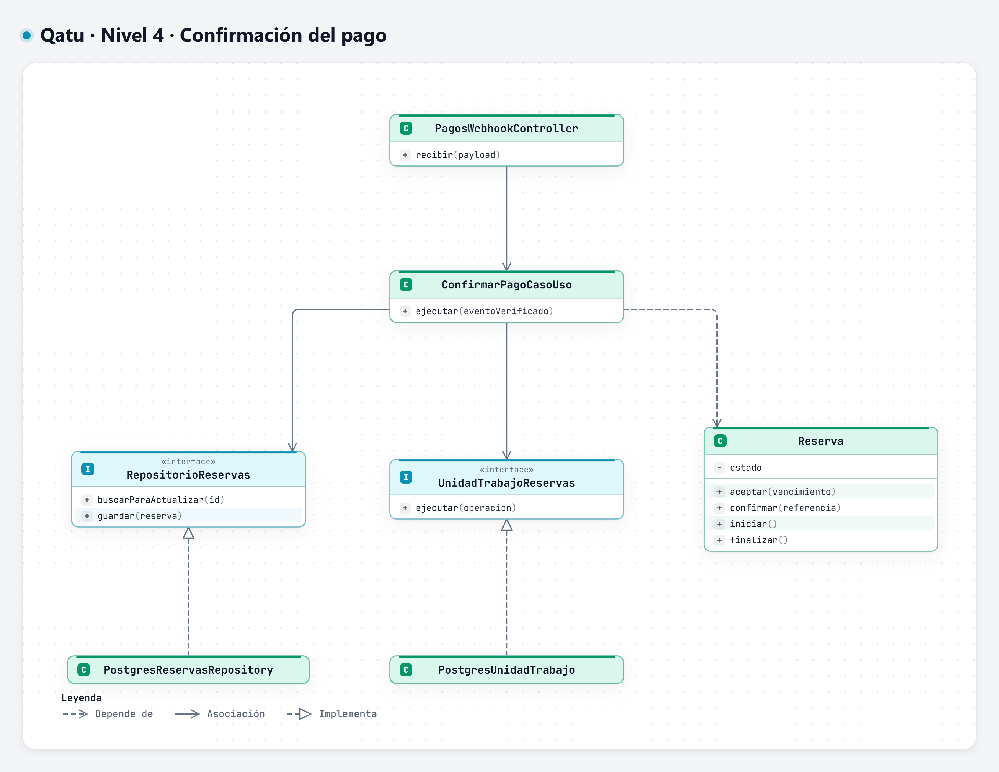
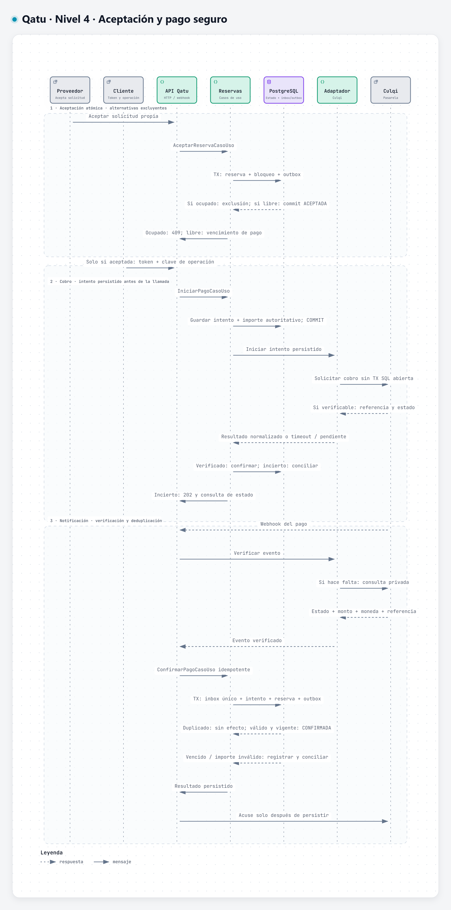
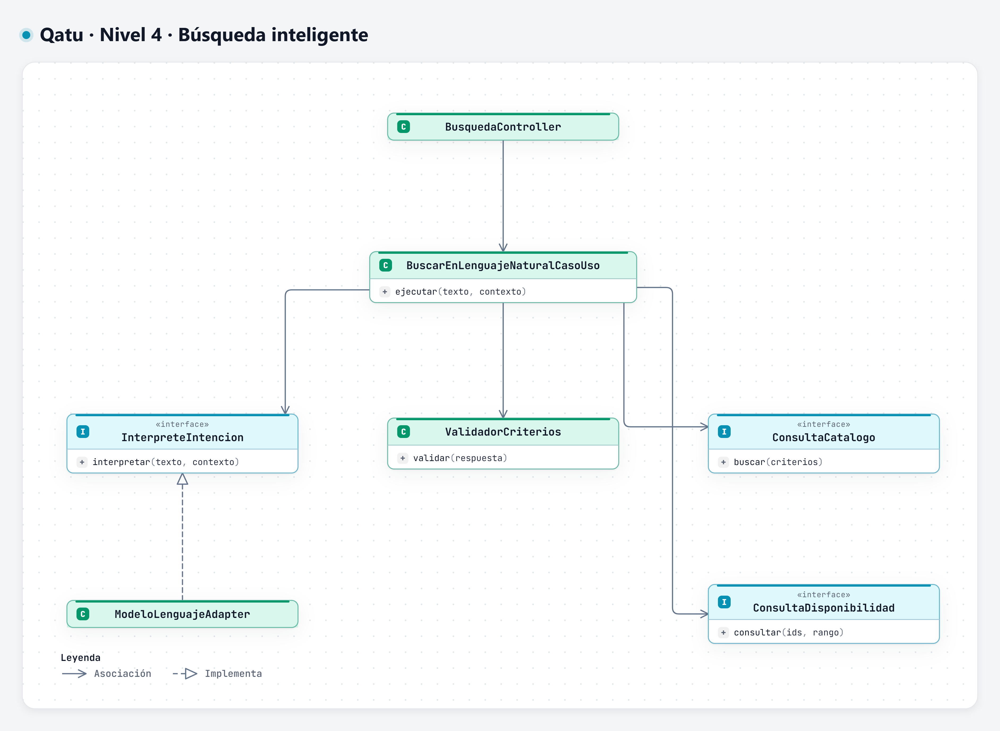
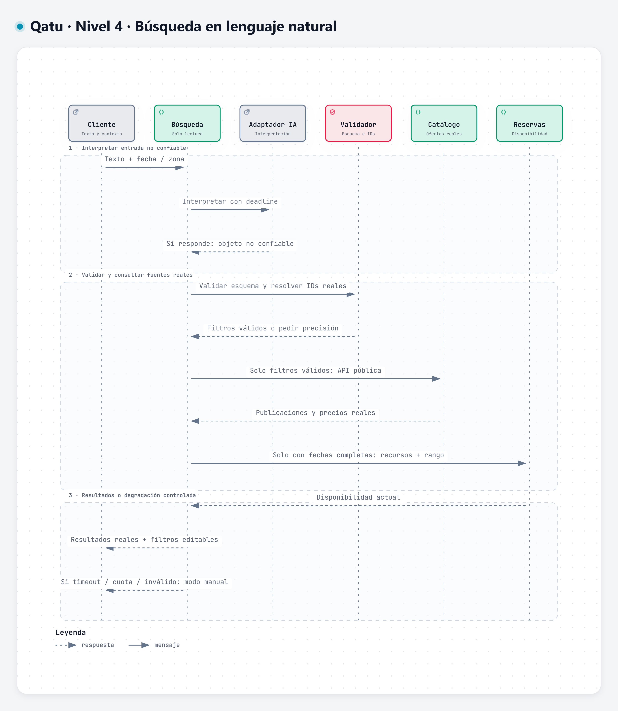

# Nivel 4 - Código de Reservas y Búsqueda inteligente

Diagramas de diseño propuesto generados con Archify. Las imágenes PNG se pueden ampliar; los enlaces incluyen el visor HTML y la fuente JSON editable.

## Objetivo y estado

Detallar clases e interfaces de los componentes críticos del nivel 3. Notación UML generada con Archify y publicada en PNG. Es código diseñado, todavía no implementado. Pagos es un componente interno de Reservas.

## Clases de Reservas y pagos

### Aceptación de reserva

[Abrir PNG](./diagramas/png/nivel4-clases-aceptacion.png) · [Visor Archify](./diagramas/html/nivel4-clases-aceptacion.html) · [Fuente editable](./diagramas/fuentes/nivel4-clases-aceptacion.archify.json)

### Inicio del pago

[Abrir PNG](./diagramas/png/nivel4-clases-inicio-pago.png) · [Visor Archify](./diagramas/html/nivel4-clases-inicio-pago.html) · [Fuente editable](./diagramas/fuentes/nivel4-clases-inicio-pago.archify.json)

### Confirmación del pago

[Abrir PNG](./diagramas/png/nivel4-clases-confirmacion.png) · [Visor Archify](./diagramas/html/nivel4-clases-confirmacion.html) · [Fuente editable](./diagramas/fuentes/nivel4-clases-confirmacion.archify.json)

Asociación: -->; dependencia: ..>; realización: ..|>; composición: *--. Puerto de pagos y repositorio no importan sus implementaciones. Unidad de trabajo conecta repositorios transaccionales de Reserva, IntentoPago, Inbox y Outbox; no se omiten del diseño financiero aunque no se dibujen todas las clases auxiliares.

## Secuencia: aceptar y pagar

[Abrir PNG](./diagramas/png/nivel4-secuencia-pagos.png) · [Visor Archify](./diagramas/html/nivel4-secuencia-pagos.html) · [Fuente editable](./diagramas/fuentes/nivel4-secuencia-pagos.archify.json)

Una respuesta aprobada verificada y un webhook recorren la misma lógica idempotente. Para reservas vencidas, el pago no vuelve a bloquear fechas: se gestiona ajuste/reembolso. El publicador procesa outbox después del commit y registra entregas; no está dentro del cobro. No se borra el intento rechazado.

## Clases de búsqueda inteligente

[Abrir PNG](./diagramas/png/nivel4-clases-busqueda.png) · [Visor Archify](./diagramas/html/nivel4-clases-busqueda.html) · [Fuente editable](./diagramas/fuentes/nivel4-clases-busqueda.archify.json)

## Secuencia: búsqueda natural

[Abrir PNG](./diagramas/png/nivel4-secuencia-busqueda.png) · [Visor Archify](./diagramas/html/nivel4-secuencia-busqueda.html) · [Fuente editable](./diagramas/fuentes/nivel4-secuencia-busqueda.archify.json)

No se consulta disponibilidad cuando faltan fechas; la interfaz indica que debe especificarlas. Ninguna flecha de búsqueda ejecuta pago o reserva.

## Verificación

EQ-05: imports y sustitución. EQ-07: exclusión con BD real. EQ-08: eventos y pagos inciertos. EQ-10: filtros/resultados autorizados.

[Nivel 3](./Nivel3-Diagrama-de-Componentes.md) · [Diseño interno](../03-diseño-de-software/diseño-interno/diseño-interno-de-modulos.md).
