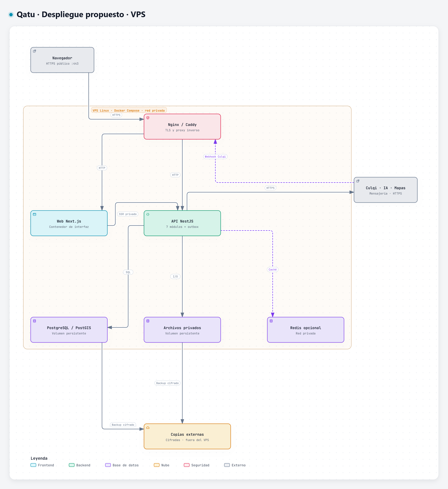

# Despliegue inicial de Qatu en VPS

Diagramas de diseño propuesto generados con Archify. Las imágenes PNG se pueden ampliar; los enlaces incluyen el visor HTML y la fuente JSON editable.

## Alcance

Vista de despliegue complementaria a C4. Un VPS Linux con Docker Compose; siete módulos en una API NestJS, web Next.js y PostgreSQL. Redis opcional. Configuración operativa propuesta; no es un despliegue realizado.

[Abrir PNG](./diagramas/png/despliegue-vps.png) · [Visor Archify](./diagramas/html/despliegue-vps.html) · [Fuente editable](./diagramas/fuentes/despliegue-vps.archify.json)

## Operación y límites

| Elemento | Diseño |
|---|---|
| Puertos públicos | 443; 80 solo para redirección/certificado; SSH restringido |
| Puertos privados | Web, API, PostgreSQL y Redis sin publicación pública |
| Persistencia | Volúmenes para BD y archivos; reconstruir imagen no elimina datos |
| Secretos | Variables/archivos protegidos fuera de Git; llave pública de checkout separada de privada |
| Salud | Liveness del proceso; readiness con DB; fallo IA no invalida disponibilidad de reservas |
| Reinicio | Política de reinicio del servicio; no reemplaza recuperación del host |
| Observabilidad | Logs JSON con correlationId, métricas de latencia/error y alertas de backups/pagos desconocidos |
| Copias | Diarias, cifradas y externas; retención propuesta 7 diarias y 4 semanales; restauración ensayada |
| Despliegue | Imagen etiquetada por commit; migraciones controladas; rollback compatible con esquema |
| IP real del visitante | Traefik (incluido en Dokploy) termina HTTPS y escribe `X-Forwarded-For`; la API con `QATU_PROXIES_CONFIABLES=uniquelocal`. Ver abajo |

No dimensionar con números inventados: escoger VPS después de prueba EQ-01/EQ-03 y registrar costo, RAM, CPU, disco y límites. EQ-09 propone RPO de 24 h y RTO de 4 h; pagos posteriores a la copia requieren conciliación externa.

## Dokploy: proxy, red interna e IP real

Dokploy incluye **Traefik** como proxy inverso: recibe 80/443, obtiene y renueva el certificado HTTPS y enruta a los contenedores. No hace falta Nginx.

| Servicio | Exposición | Variables clave |
|---|---|---|
| Web (Next.js) | Único servicio con dominio en Dokploy (HTTPS activado) | `QATU_API_URL=http://<servicio-api>:3001` |
| API (NestJS) | Sin dominio ni puerto publicado; solo red interna | `QATU_HOST=0.0.0.0`, `APP_ORIGIN=https://<dominio>`, `QATU_PROXIES_CONFIABLES=uniquelocal`, `NODE_ENV=production` |
| PostgreSQL | Sin puerto publicado | `DATABASE_URL` interna |

- **`QATU_HOST=0.0.0.0`.** Por defecto la API escucha solo en 127.0.0.1. En un contenedor eso la deja inalcanzable para la web, que corre en otro contenedor. Como no tiene dominio ni puerto publicado, escuchar en 0.0.0.0 la expone solo a la red interna de Docker.
- **IP real.** El proxy de Next.js (`/api/v1` → API) **no agrega** `X-Forwarded-For`: reenvía la que trae la petición. Traefik sí la escribe con la IP real del visitante. La API, que recibe la petición desde la IP privada del contenedor web, confía en las direcciones privadas (`uniquelocal`). Express recorre la cabecera de derecha a izquierda y toma la primera IP pública, la que puso Traefik; una IP falsa enviada por el visitante queda a la izquierda y se ignora. Los valores `true` o un número de saltos se rechazan al arrancar.
- **Comprobar tras desplegar.** En los registros de acceso de Traefik cada visitante debe aparecer con su IP pública. Si todos aparecen con la puerta de enlace de Docker (por ejemplo `172.18.0.1`, típico con IPv6 o con el proxy de espacio de usuario de Docker), hay que corregir la publicación de puertos antes de confiar en los límites por IP.
- **Si se agrega Cloudflare** u otro proxy delante de Traefik, declarar sus rangos en `forwardedHeaders.trustedIPs` del entrypoint de Traefik.
- **Sin `QATU_PROXIES_CONFIABLES`** la API usa la IP de la web y los límites por IP (30 inicios de sesión cada 15 min) son comunes a todo el sitio; en producción lo advierte en el log al arrancar.

## Secuencia de publicación

1. Construir imágenes, verificar configuración y ejecutar pruebas críticas.
2. Respaldar DB/archivos y comprobar espacio.
3. Aplicar migraciones compatibles, publicar imágenes y verificar readiness.
4. Ejecutar smoke test de búsqueda, reserva, permisos y pago sandbox.
5. Si falla, volver a imagen anterior solo si es compatible con el esquema; restaurar bajo procedimiento cuando corresponda.

## Evolución

Primero optimizar consultas y medir. Después evaluar más recursos o réplicas de API con almacenamiento compartido. Réplicas dentro del mismo host no ofrecen alta disponibilidad ante caída de VPS. Extraer IA solo si existe necesidad demostrada de carga/despliegue independiente; preservar contratos, costos y seguridad.

[Contenedores](./Nivel2-DiagramadeContenedores.md) · [Escenarios](../01-analisis-de-sistema/08-escenarios-atributos-calidad.md).
