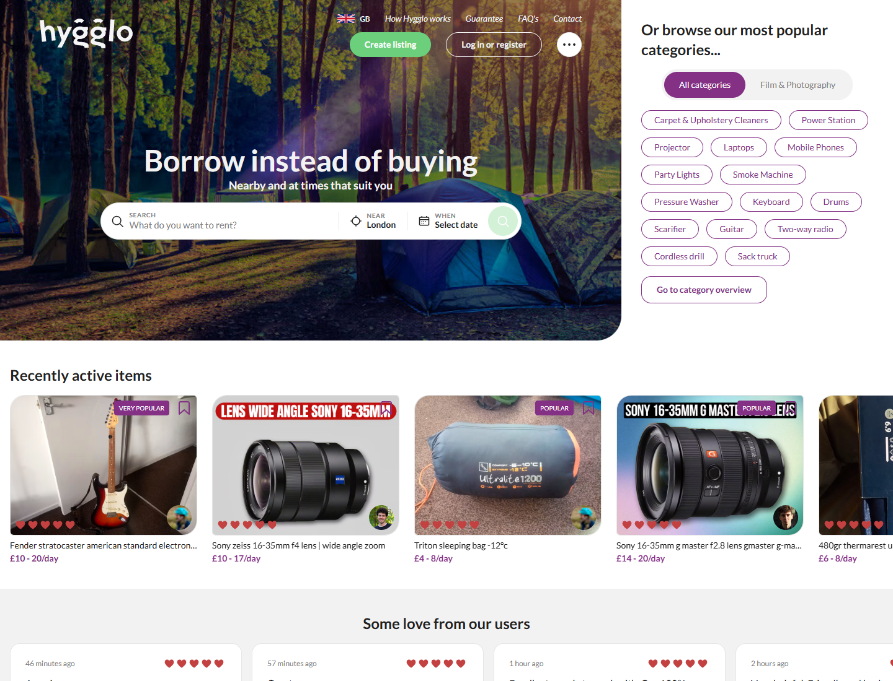
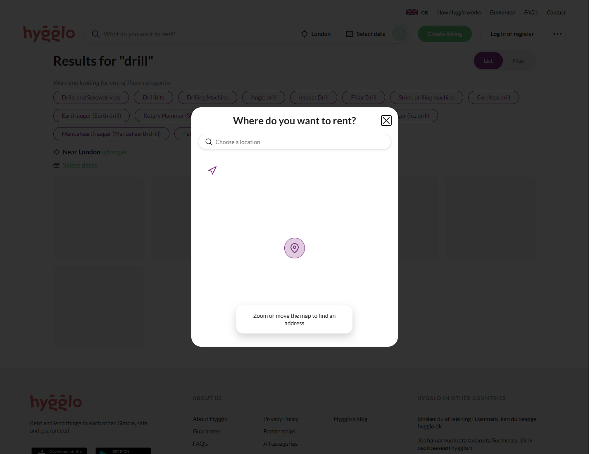
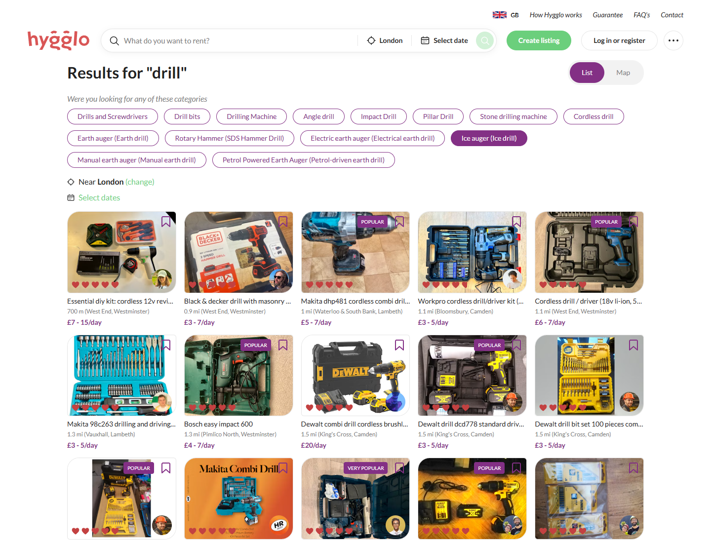
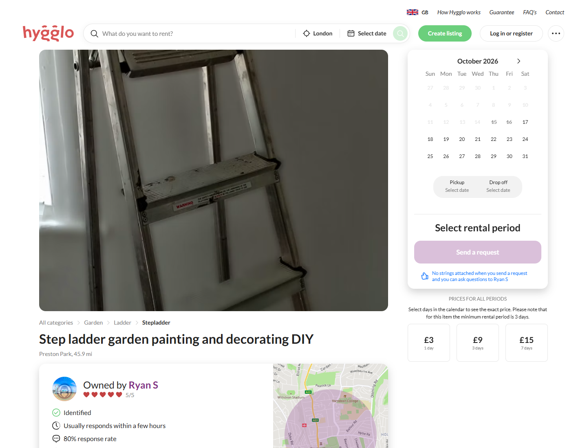
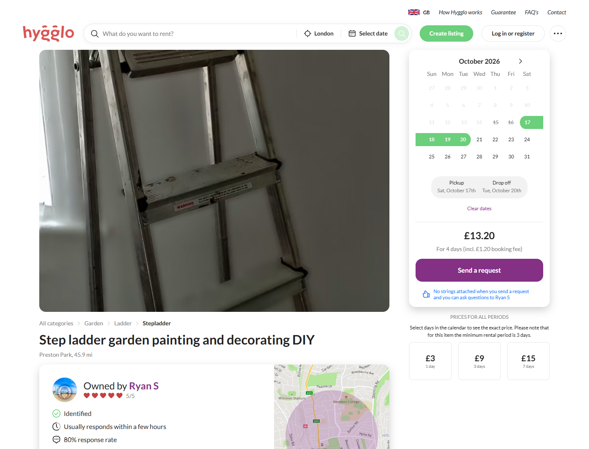
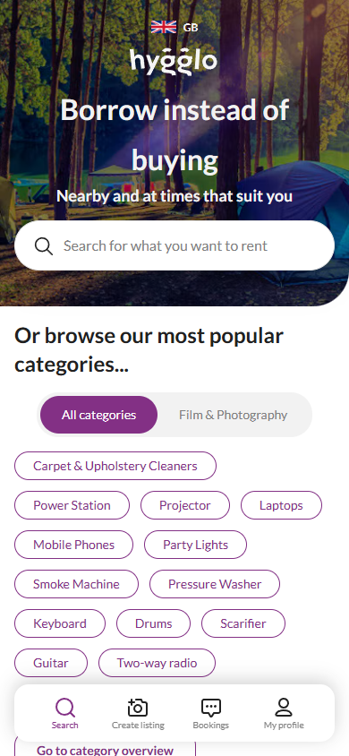

# Análisis funcional y visual de Hygglo

## 1. Identidad y alcance

Fecha de investigación: 15/10/2026, zona de usuario America/Lima. Sitio seleccionado: [Hygglo UK](https://hygglo.com/uk). Navegación automatizada controlada por REA, navegador temporal sin sesión y cierre verificado por el proveedor. No se registraron cuentas, enviaron mensajes, solicitudes ni pagos.

Entorno de captura: navegador Chromium 155.0.8059.41, modo headless, locale en-GB, timezone Europe/London, viewport de escritorio 1440 × 1100 y móvil 390 × 844. Esa zona horaria configura el navegador analizado; no cambia el calendario del proyecto Qatu en America/Lima. Las capturas son de viewport, no de página completa.

Las evidencias E01-E07 se vinculan por ID completo en el [registro](./evidencias/README.md). Se conserva el paquete original con DOM, accesibilidad, acciones y limitaciones.

## 2. Inicio en escritorio — E01

**Observado:** encabezado sobre fotografía principal, propuesta de valor destacada, buscador segmentado por artículo/ubicación/fechas, accesos a publicación e identificación, categorías rápidas y carrusel de objetos. Las tarjetas muestran fotografía, título, tarifa diaria y elementos visuales de confianza.

**Interpretación:** la portada prioriza descubrir una oferta antes de crear una cuenta. La composición separa búsqueda dirigida de exploración por categorías. No demuestra tasas de conversión ni el algoritmo de recomendación.

**Adaptación propuesta:** buscador de necesidad en español, Ayacucho como zona inicial visible, selector herramienta/oficio y fechas editables. La IA debe devolver filtros comprobables; un buscador de texto convencional no demuestra que Hygglo use IA.

## 3. Búsqueda de taladros — E02 y E06

Acción ejecutada en E02: abrir inicio, esperar el campo, introducir drill y pulsar Enter. Se observó la ruta /uk/search/drill y un diálogo que pide ubicación. No se seleccionó una dirección ni se usó geolocalización del usuario.

En E06 se abrió la ruta de búsqueda ya observada, se cerró el diálogo mediante su botón visible y se esperó la carga. Apareció un listado de herramientas con fotografía, descripción abreviada, distancia/zona y tarifa diaria, además de categorías relacionadas y controles de lista/mapa. No se pulsó el control de mapa: su funcionamiento posterior no está comprobado.

**Límites:** la captura conserva la zona predeterminada London. No prueba ubicación real del usuario ni un ordenamiento universal por distancia. La apariencia activa de una categoría en la imagen no demuestra que se aplicara ese filtro: no se declaró un clic sobre categorías. No se evaluaron filtros de precio ni búsqueda sin resultados.

**Adaptación propuesta:** pedir zona explícita sin bloquear toda la exploración, mostrar filtros activos, permitir borrarlos y añadir estado vacío con sugerencias. Una herramienta sin fechas puede mostrarse, pero no debe presentarse como disponible para un periodo no consultado.

## 4. Detalle de una publicación — E03

Se tomó una publicación enlazada desde la portada: [escalera para trabajos domésticos](https://hygglo.com/uk/i/12a-step-ladder-garden-painting-and-decorating-diy). No procede del listado de taladros; se eligió como objeto cercano al uso de herramientas para reparación.

**Observado en la captura y accesibilidad:** fotografía principal amplia; ruta de categorías; título; zona; enlace al propietario; indicadores de identificación y respuesta; reseñas del proveedor; descripción y cancelación; calendario y panel de importe a la derecha.

Antes de elegir fechas, el botón de solicitud está deshabilitado. La página informa un mínimo de tres días para este objeto y muestra referencias de precio para distintas duraciones. No se pulsó el botón de contacto ni se verificaron las garantías promocionadas por el sitio.

**Adaptación propuesta:** detalle con fotos, características, condiciones, proveedor y panel de reserva. Diferenciar reseñas del proveedor de reseñas de una herramienta. Mostrar garantía documental, comisión y conceptos cobrables por separado; no trasladar la cobertura publicitada por Hygglo a Qatu.

## 5. Calendario y cotización — E04

Acciones: abrir la misma publicación, seleccionar los días 17 y 20 del calendario visible de octubre de 2026 y esperar la actualización.

**Observado:** el periodo queda resaltado; la interfaz muestra cuatro días, total de £13.20 y comisión de reserva incluida de £1.20; se habilita el botón para solicitar. Son importes de esta captura, no tarifas recomendadas para Qatu. No se envió la solicitud.

**Diferencia relevante:** para este ejemplo Hygglo cuenta ambos días del calendario. Qatu documenta rangos temporales [inicio, fin) para controlar solapamientos; esa regla de disponibilidad y la regla comercial de días facturados deben especificarse por separado. No se cambia silenciosamente el cálculo actual por imitación.

**Decisión pendiente:** definir si un alquiler diario cobra días calendario inclusivos o bloques de 24 horas, hora exacta de devolución, mínimos y redondeo. Presentar al usuario el número de días y el desglose antes de solicitar. Backend recalcula siempre.

## 6. Inicio móvil — E05 y E07

La primera captura E05 conserva un oscurecimiento de la página y elementos promocionales de app en la representación de accesibilidad; no se usa como estado final del diseño. En E07 REA pulsó la opción observada para continuar en el sitio web y obtuvo la portada sin ese estado transitorio.

**Observado:** buscador compacto como acción única, categorías debajo del bloque principal y navegación inferior con búsqueda, publicación, reservas y perfil. Se comprueba adaptación visual en un tamaño; no rendimiento real, accesibilidad completa, dispositivos físicos ni todos los breakpoints.

**Adaptación propuesta:** menú inferior Buscar / Publicar / Reservas / Perfil; formularios por pasos, controles táctiles amplios y búsqueda sin instalación de app. El acceso a publicar verifica el rol de proveedor al iniciar la operación.

## 7. Lo que no se puede concluir

No se establecieron el lenguaje o arquitectura del backend, modelo de base de datos, transacciones, pasarela, APIs de pago o algoritmo de búsqueda. No se capturaron cuerpos de red ni se siguieron solicitudes con autenticación. Los indicadores de identificación y cobertura son elementos publicados; no evidencia de su procedimiento interno.

El uso visual de un calendario no garantiza ausencia de dobles reservas: Qatu conserva sus requisitos de consistencia y pruebas PostgreSQL. La tarifa vista no permite deducir una fórmula global de comisiones.

## 8. Conclusión de esta etapa

Se observaron la portada, búsqueda pública, detalle, actualización de una cotización y una adaptación móvil. El flujo autenticado, pago, cancelación ejecutada, entrega/devolución y publicación siguen pendientes. La [matriz](./02-matriz-adaptacion-qatu.md) convierte estos hallazgos en propuestas verificables para Qatu.
