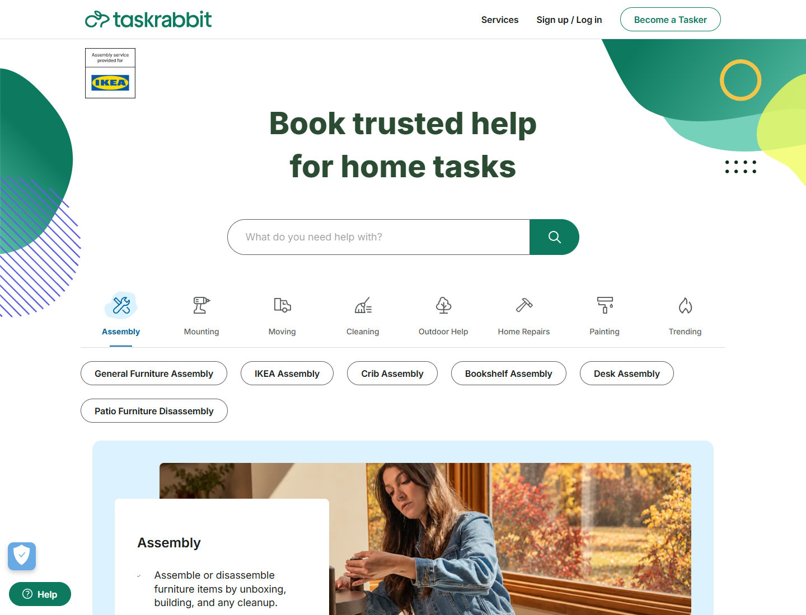
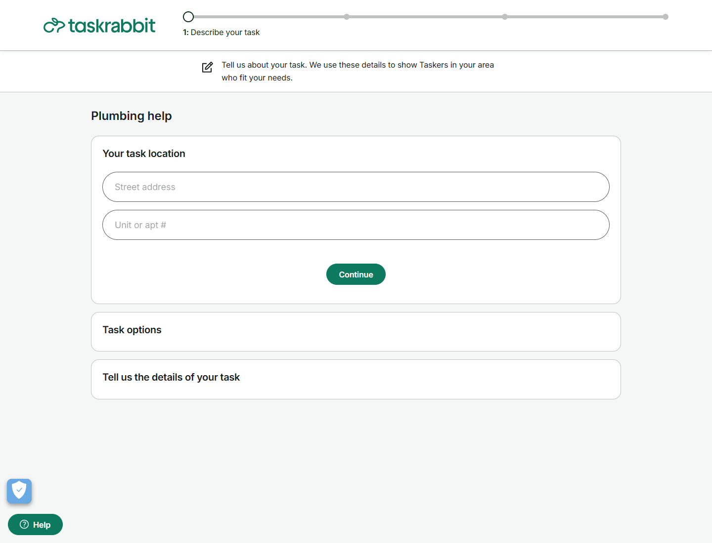
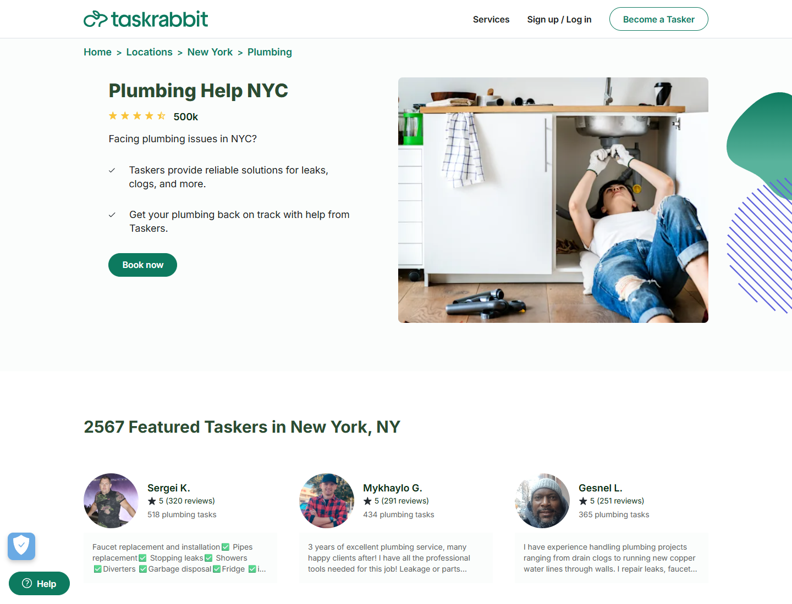

# Análisis funcional y visual de Taskrabbit

Investigación: 15 de octubre de 2026. Complementa [Hygglo](./01-analisis-hygglo.md) para el dominio de contratación de oficios. Observación pública con REA; sin cuenta, datos personales, solicitudes enviadas ni pagos. Las páginas estudiadas corresponden a Estados Unidos; sus tarifas y condiciones no se trasladan a Ayacucho.

## Preguntas y cobertura

| Pregunta | Resultado | Evidencia |
|---|---|---|
| ¿Cómo descubre el usuario un oficio? | Buscador de necesidad, categorías y directorio de tareas | T01, T03 |
| ¿Qué información describe el servicio? | Alcance, ejemplos de trabajos y entrada a contratación | T04 |
| ¿Cómo se presentan los profesionales? | Fichas destacadas por zona con foto, puntuación, reseñas, trabajos y descripción | T05 |
| ¿Qué solicita el inicio de contratación? | Ubicación; secciones de opciones y descripción; indicador de etapas | T02 |
| ¿Cómo se selecciona realmente una hora? | No observado; solo se vio la etapa anunciada | Pendiente |
| ¿Cómo se calcula o acepta una cotización? | No observado en operación; existen referencias descriptivas a precios | Pendiente |
| ¿Cómo funcionan pago, chat y cancelación? | Mencionados en el contenido público, sin ejecución | Pendiente |

## Recorrido ejecutado

REA abrió cada URL en un navegador temporal independiente, esperó 2–3 segundos y capturó URL, DOM, accesibilidad y pantalla. Los enlaces se obtuvieron de páginas previamente observadas. No se rellenó ni continuó el formulario de contratación. Chrome cerró los cinco procesos propios al terminar.

| Ref. | Página | Fuente del enlace |
|---|---|---|
| T01 | [Inicio](https://www.taskrabbit.com/) | Plataforma elegida para esta investigación |
| T02 | [Inicio de solicitud de gasfitería](https://www.taskrabbit.com/book/2055/details) | Enlace de gasfitería de T01 |
| T03 | [Directorio de servicios](https://www.taskrabbit.com/services) | Navegación de T01 |
| T04 | [Gasfitería](https://www.taskrabbit.com/services/handyman/plumbing) | Directorio T03; viewport móvil 390 × 844 |
| T05 | [Gasfitería en Nueva York](https://www.taskrabbit.com/locations/new-york-city/plumbing) | Enlace de ciudad en T04 |

T01/T02/T03/T05: viewport 1440 × 1100. Locale en-US y zona America/New_York; configuración de observación, no localización propuesta para Qatu. Capturas del viewport; el DOM también contiene secciones fuera de la pantalla visible. No se midió rendimiento ni se capturaron transacciones de red.

## Hallazgos observados y adaptación

### 1. Descubrimiento por necesidad

T01 presenta una entrada de búsqueda, categorías de trabajos y accesos a tareas concretas. T03 organiza servicios en grupos y especialidades. La entrada observada no demuestra interpretación con IA.

**Propuesta Qatu:** búsqueda natural con dos tipos de oferta visibles, categorías locales y filtros editables. Mantener búsqueda convencional si falla la IA. Evitar ampliar el MVP con todas las categorías de la referencia.

### 2. Contratación por pasos

T02 muestra cuatro etapas: descripción del trabajo, comparación de profesionales/precios, fecha/hora y confirmación. En la primera etapa están el campo de dirección, unidad opcional y secciones de opciones y descripción. Las etapas posteriores aparecen deshabilitadas en este estado. No se comprobó su comportamiento posterior ni las validaciones de los campos.

**Propuesta Qatu:** solicitar especialidad, distrito, descripción y fecha preferida; permitir revisar antes de enviar. La dirección precisa pertenece al contexto privado de la operación. Diferenciar una preferencia horaria de una franja aceptada y bloqueada en la agenda.

### 3. Perfil y alcance de trabajo

T05 muestra fichas destacadas con foto, nombre, puntuación, cantidad de reseñas, trabajos de gasfitería y descripción. Algunas descripciones declaran experiencia, exclusiones, mínimos o cargos adicionales. Son contenido mostrado por la plataforma/proveedor; no verificamos la veracidad ni que la misma política se aplique a todos. La sección es una selección pública por ciudad, no resultados filtrados por fecha ni disponibilidad comprobada.

**Propuesta Qatu:** separar especialidad, experiencia declarada, trabajos completados en Qatu y verificación documental. Describir qué incluye y excluye el servicio. La cotización aceptada debe fijar mano de obra, materiales incluidos/excluidos, movilidad, duración estimada, vigencia y total antes de cobrar, según la política finalmente especificada.

### 4. Presentación móvil y confianza

T04 muestra una columna, menú compacto, descripción del servicio, ruta de navegación y acción principal de contratación. El DOM contiene explicación del proceso, preguntas frecuentes y enlaces por ciudad; no se abrieron los acordeones. No se inspeccionó el menú móvil ni el flujo móvil de pago.

La plataforma publica mensajes sobre comprobación de antecedentes y protección. Son afirmaciones de Taskrabbit. **Qatu conservará su verificación y garantía documental propias**, sin atribuirse seguros o coberturas equivalentes.

## Flujo propuesto para Qatu

1. Buscar un oficio por necesidad y distrito.
2. Examinar servicio y proveedor, alcance, reputación y modalidad de precio.
3. Describir el trabajo y proponer fecha/franja; enviar solicitud autenticada.
4. Para precio variable, recibir y aceptar una versión de cotización vigente.
5. Aceptar la reserva y bloquear agenda de forma atómica conforme a los estados del proyecto. La propuesta de fecha y la solicitud pendiente no bloquean.
6. Pagar el importe autorizado por el servidor con Culqi/medio Yape habilitado; mostrar el estado verificado.
7. Registrar ejecución, cierre, evidencias y reseña de operación finalizada.

Este recorrido es diseño Qatu basado en RF06/RF07/RF09/RF18–RF23. El orden exacto entre aceptación de cotización y aceptación de reserva debe quedar resuelto en la especificación antes de programar; no se deduce del formulario Taskrabbit.

## Límites y cierre de etapa

Descubrimiento, contenido público del servicio, fichas resumidas y entrada de contratación: observados. Perfil completo, agenda interactiva, cálculo real, aceptación, chat, pago, devolución y administración: no observados. No se ha determinado su arquitectura interna, almacenamiento ni contratos API. El análisis público ya permite especificar patrones iniciales; no prueba un recorrido de contratación completo.

[Evidencias y hashes](./evidencias/README.md) · [Matriz Qatu](./02-matriz-adaptacion-qatu.md) · [Preparación SDD](./05-transicion-sdd-spec-kit.md).
